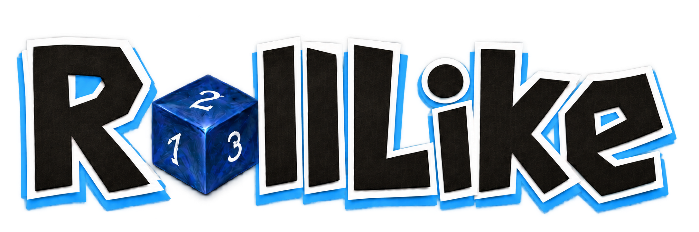

<div align="center">
  
  <h1>RollLike · 随机工具</h1>
  <p>《明日方舟》集成战略开局、局内招募与挑战词条随机工具</p>
  <p>随机生成开局，按局内招募券提供可选结果，并从不同来源的词条池抽取随机挑战。</p>
  <p>
    <a href="https://slayerwalt.github.io/ArkRogueStartRandomizer/"><strong>在线使用</strong></a>
    ·
    <a href="#本地开发">本地开发</a>
  </p>
  <p>
    
    
    
    
  </p>
</div>

## 项目简介

RollLike（中文名：随机工具）用于决定集成战略的开局。进入“随机开局”时，先在弹窗中选择并确认一种开局方式。“随心所欲开局”对应游戏中的“随心所欲”：玩家按实际随机获得的三张招募券填写职业，工具为每张券随机提供三名六星，再由玩家从本轮结果中确认一名开局干员，其余干员自行搭配。分队可以手动选择或独立随机。

“全随机开局”可以直接随机分队、招募组合和全部开局干员，结合初始希望、分队减免和干员自身减免，为每张券随机一名当前预算能够招募的干员。

项目是纯静态网页，不需要登录，不连接游戏客户端，也没有后端服务。游戏数据和图片资源在构建时打包，浏览器只负责随机计算和保存本地设置。

## 当前支持

| 集成战略主题 | 状态 |
|---|---|
| 傀影与猩红孤钻 | 主题入口与展示图已提供，随机功能开发中 |
| 水月与深蓝之树 | 主题入口与展示图已提供，随机功能开发中 |
| 探索者的银凇止境 | 主题入口与展示图已提供，随机功能开发中 |
| 萨卡兹的无终奇语 | 主题入口与展示图已提供，随机功能开发中 |
| 岁的界园志异 | 主题入口与展示图已提供，随机功能开发中 |
| **沉沦者的黑流树海** | **已开放** |

## 本地开发

需要 Node.js `^20.19.0` 或 `>=22.12.0`，以及随 Node.js 提供的 npm。

```powershell
git clone https://github.com/slayerwalt/ArkRogueStartRandomizer.git
cd ArkRogueStartRandomizer
npm ci
npm run dev
```

常用命令：

| 命令 | 用途 |
|---|---|
| `npm run dev` | 启动本地开发服务器 |
| `npm run build` | 构建生产版本 |
| `npm run typecheck` | 运行 TypeScript 类型检查 |
| `npm test` | 运行 Vitest 测试 |
| `npm run extract -- <资源仓库路径>` | 从游戏资源仓库更新项目数据 |

## 数据与素材来源

- 游戏结构化数据：[ArknightsGameResource](https://github.com/yuanyan3060/ArknightsGameResource)
- 干员头像：[ArknightsAssets2](https://github.com/ArknightsAssets/ArknightsAssets2)，个别缺失素材补充自 [PRTS Wiki](https://prts.wiki/)
- 集成战略主题图与分队图标：[路标档案馆](https://lubiao.wiki/)，新增分队图标补充自 [ArknightsAssets2](https://github.com/ArknightsAssets/ArknightsAssets2)
- 招募券图片：[ArknightsAssets2](https://github.com/ArknightsAssets/ArknightsAssets2) 的黑流树海原图，共 15 张，用于“随机抽取干员”的招募券选择卡片。
- RollLike Logo：使用 ImageGen 制作，骰子造型参考游戏素材。

感谢上述项目和社区资料站的维护者。为避免上游地址变化影响使用，当前所需图片均已下载并随项目打包，网页不使用运行时热链。

## 反馈与贡献

发现规则错误、数据遗漏或功能问题时，欢迎提交 [Issue](https://github.com/slayerwalt/ArkRogueStartRandomizer/issues)。如果修改了随机规则，请同时补充相应测试；涉及游戏版本变化时，请在提交前检查生成数据的差异摘要。

## 声明

本项目是由玩家制作的非官方工具，与《明日方舟》及其开发、发行方不存在隶属或合作关系。游戏名称、图像及相关素材的权利归其各自权利人所有，本项目仅供学习与交流使用。
